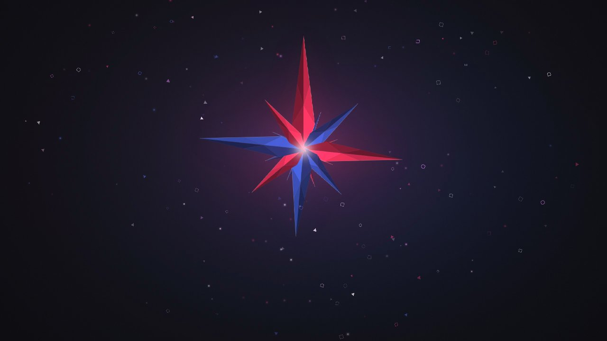
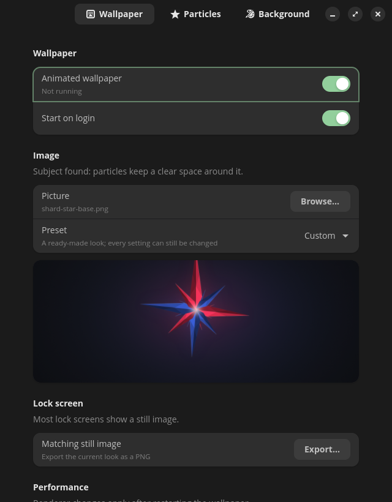
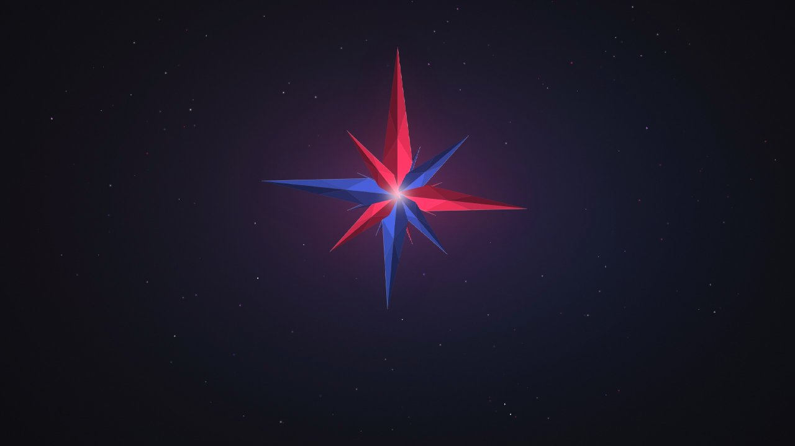
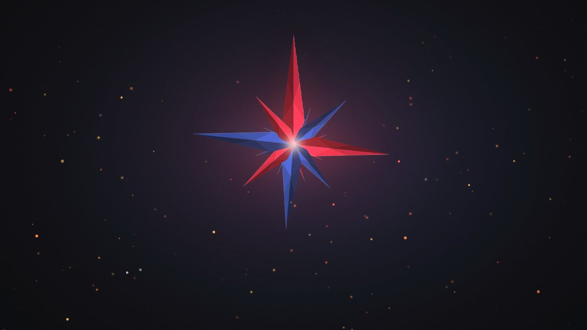
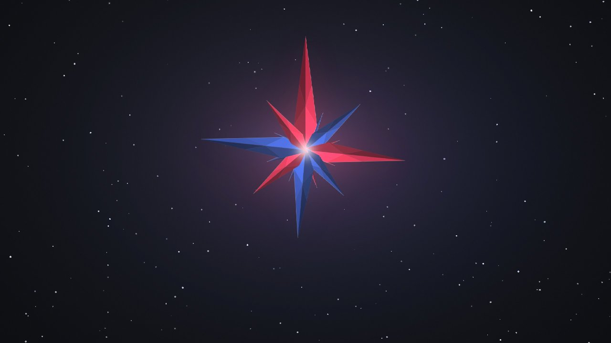
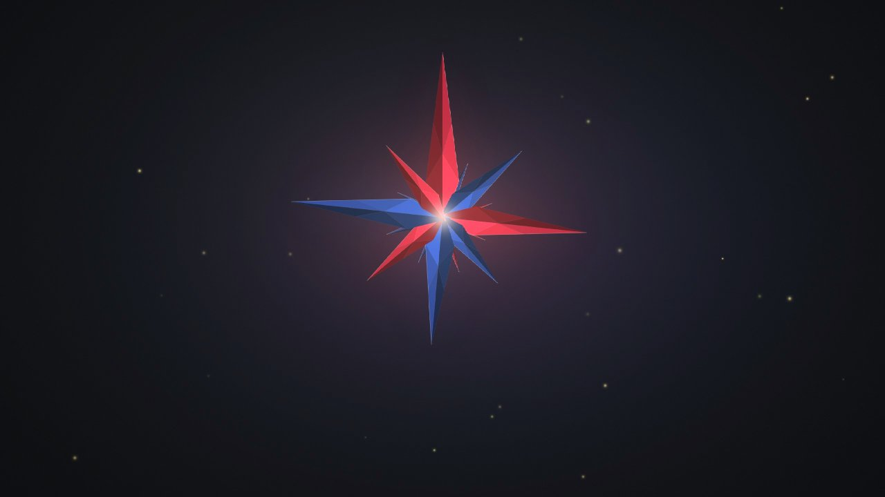
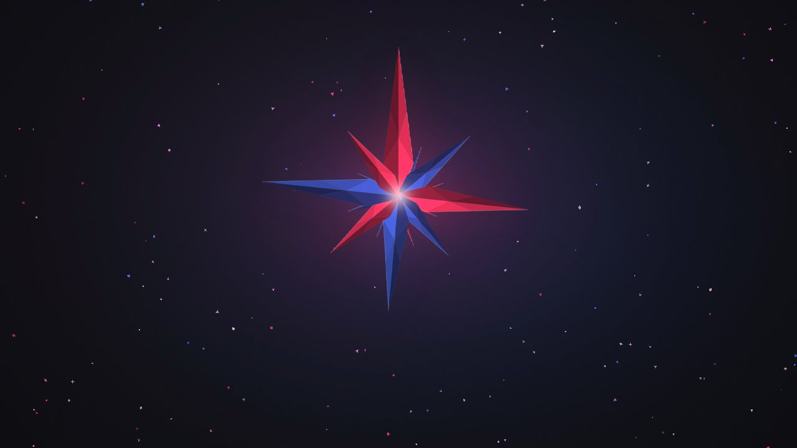

# driftpaper

Animated particle wallpapers for Wayland. Give it any image: driftpaper finds the subject,
takes particle colours from it, and animates particles, a drifting colour fog and a soft
breathing glow around it. It uses well under 1% of one CPU core on a GPU.



## Features

- **Settings window.** Pick an image with a file browser, choose a preset and tweak everything
  while the wallpaper updates live. Turn the wallpaper on or off and start it on login from there.
- **Works with any image.** The subject's position and size are detected automatically, and the
  particles keep a clear space around it. Images without a clear subject get particles everywhere.
- **Colours from the image.** The particle palette and glow are taken from the picture itself.
- **8 shapes:** triangle, square, spark, circle, ring, diamond, star and plus, mixed by weight.
- **4 motions:** orbit around the subject, rise, fall and drift.
- **7 presets:** shards, stardust, geometric, embers, snow, fireflies and confetti.
- **Live config:** edit the config file while it runs and changes apply within a second.
- **GPU or CPU rendering**, with lower resolution and frame rate on the CPU to keep it usable.
- **Lock screen snapshots:** export a still PNG of the current look.
- **Multi-monitor:** a picture per monitor, or one picture stretched across all of them, with
  hotplugging and per-monitor on/off.
- **Sharp on HiDPI** screens, including fractional scaling.
- **Smooth crossfade** when you change the picture or look.
- **Lock screen sync on COSMIC:** the lock and login screens show a matching still.
- **Music sync:** the glow and particles pulse on the beat, with an equaliser ring in the middle of the
  screen or a glowing wave along the bottom, plus a small equaliser badge in the bottom-right
  corner.



| shards | stardust | embers |
|---|---|---|
|  |  |  |
| **snow** | **fireflies** | **confetti** |
|  |  |  |

## Requirements

A Wayland compositor with `wlr-layer-shell`: COSMIC, Sway, Hyprland, KDE Plasma, river,
Wayfire, labwc and others. GNOME is not supported because Mutter does not offer layer-shell.

## Install

### Flatpak (from Releases)

Download `driftpaper-<version>.flatpak` from the [latest release](https://github.com/Casper-RS/driftpaper/releases/latest), then:

```sh
flatpak install --user driftpaper-*.flatpak
```

Open **driftpaper** from your app menu, click **Browse…** to pick a picture and switch on
**Animated wallpaper**. The Flatpak keeps its settings in
`~/.var/app/io.github.casper_rs.driftpaper/config/driftpaper/config.ini`.

> **Why the Flatpak talks to the compositor directly:** wallpapers use the privileged
> `wlr-layer-shell` protocol, which compositors hide from Flatpak's filtered Wayland socket.
> The Flatpak therefore uses the compositor's own socket (`wayland-0` or `wayland-1`), and has
> read-only access to your home folder so it can open any image.

### Binary (from Releases)

Built on Ubuntu 24.04; the settings window needs GTK 4.14 and libadwaita 1.5 or newer.

```sh
tar xf driftpaper-*-linux-x86_64.tar.gz && cd driftpaper-*-linux-x86_64
install -Dm755 driftpaper driftpaper-settings -t ~/.local/bin
install -Dm644 dist/io.github.casper_rs.driftpaper.desktop -t ~/.local/share/applications
install -Dm644 dist/io.github.casper_rs.driftpaper.svg -t ~/.local/share/icons/hicolor/scalable/apps
```

### From source

```sh
# Debian/Ubuntu/Pop!_OS
sudo apt install build-essential libwayland-dev libegl-dev libgles-dev libgtk-4-dev libadwaita-1-dev
# Fedora
sudo dnf install gcc make wayland-devel mesa-libEGL-devel mesa-libGLES-devel gtk4-devel libadwaita-devel
# Arch
sudo pacman -S base-devel wayland mesa libglvnd gtk4 libadwaita

make
sudo make install            # or: make install PREFIX=~/.local
```

Without the GTK 4 and libadwaita development files, `make` builds only the wallpaper and the
command line works as before.

## Usage

The easiest way is the settings window: run `driftpaper-settings` or open **driftpaper** from
your app menu. Everything below is also available from the command line:

```sh
driftpaper ~/Pictures/wall.png                # run with an image (replaces a running one)
driftpaper -p embers ~/Pictures/wall.png      # use a preset
driftpaper -s count=300 -s motion=drift       # override single settings
driftpaper --list                             # presets, shapes and motions
driftpaper --analyze ~/Pictures/wall.png      # what was detected in the image
driftpaper --print-config > ~/.config/driftpaper/config.ini   # write a config to edit
```

### Start on login

Switch on **Start on login** in the settings window, or pick one of these:

```sh
# systemd user service (installed by make install)
systemctl --user enable --now driftpaper.service

# or XDG autostart, which works on every desktop
cp dist/driftpaper.desktop ~/.config/autostart/
```

For the Flatpak, use `Exec=flatpak run io.github.casper_rs.driftpaper` in the autostart file.

### Matching lock screen

On COSMIC, switch on **Keep the lock screen in sync** (or `lock_screen_sync = true`): a few seconds
after the look changes, driftpaper saves a still of each monitor to `~/.local/share/driftpaper/`
and sets it as COSMIC's background, which the lock and login screens show. This replaces the
background picked in COSMIC Settings.

Elsewhere, use **Export…** in the settings window, or:

```sh
driftpaper --snapshot ~/Pictures/driftpaper-lock.png --size 2560x1440
```

### Music sync

Switch on **React to music** on the Music page (or `music = true`). driftpaper listens to what
your speakers play through PulseAudio or PipeWire (`pipewire-pulse`), so it reacts to any player,
browser or game. It finds the beat in the bass and splits the sound into 16 bands from 40 Hz to 5 kHz.

- `music_style = ring`: equaliser bars in the middle of the screen, with a ripple on each beat.
- `music_style = wave`: a glowing, mirrored spectrum along the bottom of the screen.
- `music_style = glow`: only the glow and particles pulse.
- `music_badge = true`: a small round equaliser in the bottom-right corner of the desktop. While
  nothing plays it shows resting dots.

The visualiser fades out a moment after the sound stops. Snapshots leave it out (they are meant
for lock screens); add `--with-music` to preview it on a sample song. Listening costs about 0.3% of one core.
To listen to something other than the speakers, set `music_source` to a source name from
`pactl list short sources`.

The **Look** group on the Music page changes how the visualiser is drawn: its size, brightness,
the number of bars around the ring, the dark shadow behind the ring, and its colours (by default
the two glow colours, from bass to treble).

## Configuration

Settings live in `~/.config/driftpaper/config.ini`. [`examples/config.ini`](examples/config.ini)
lists every setting with an explanation. The most useful ones:

| Setting | Values | Meaning |
|---|---|---|
| `enabled` | `true`, `false` | Whether the wallpaper runs; turning it off stops a running one |
| `image` | path | The picture to animate |
| `preset` | `shards`, `stardust`, `geometric`, `embers`, `snow`, `fireflies`, `confetti` | Starting point, other keys override it |
| `renderer` | `auto`, `gpu`, `cpu` | `gpu` prefers the dedicated GPU, `cpu` uses software rendering |
| `fps` | `auto` or 1-240 | 30 on the GPU, 12 on the CPU |
| `render_scale` | `auto` or 0.25-1 | Render at a fraction of the resolution (compositor scales it up) |
| `count` | number | How many particles |
| `motion` | `orbit`, `rise`, `fall`, `drift` | How particles move |
| `shapes` | e.g. `triangle:2, spark` | Which shapes, with optional weights |
| `size` | e.g. `9-20` | Size range in pixels at 1440p |
| `speed`, `speed_falloff` | numbers | Speed, and how much faster the outer orbit moves |
| `inner_radius`, `outer_radius` | `auto` or a fraction of the image height | Clear zone around the subject, and the edge of the particle field |
| `colors` | `auto` or `#ff3366, #5577ee` | Particle colours |
| `fog`, `glow` | 0 disables | Background effects |
| `hue_adjust` | e.g. `220, 40, -0.2` | Darken or lighten one colour range of the image |
| `outputs` | `all` or `DP-1, HDMI-A-1` | Which monitors to draw on |
| `image.<monitor>` | path | A different picture for one monitor, e.g. `image.DP-2` |
| `span` | `true`, `false` | Stretch the main picture across all monitors |
| `lock_screen_sync` | `true`, `false` | COSMIC: keep the lock and login screens matching |
| `music` | `true`, `false` | React to the music that is playing |
| `music_style` | `ring`, `wave`, `glow` | How the music is shown |
| `music_badge` | `true`, `false` | Equaliser badge in the bottom-right corner |
| `music_sensitivity` | 0.1-5 | How strongly the look reacts |
| `music_size` | 0.5-2 | Ring size and wave height |
| `music_brightness` | 0-3 | Brightness of the ring, wave and badge |
| `music_bars` | 24-144 | Number of bars around the ring |
| `music_shadow` | 0-1 | Dark band behind the ring for bright pictures |
| `music_colors` | `auto` or `#rrggbb, #rrggbb` | Visualiser colours, bass then treble; `auto` uses the glow colours |

### CPU usage

Measured on two 2560×1440 monitors:

| Renderer | Settings | CPU |
|---|---|---|
| GPU (NVIDIA RTX 4070 Super) | defaults (30 fps) | ~0.8% of one core |
| CPU (Mesa llvmpipe) | defaults (12 fps, render_scale 0.35) | ~75% of one core |

The CPU renderer is meant for machines without working graphics drivers. Lower `fps`,
`render_scale` or set `fog = 0` to make it cheaper.

## Development

```
src/main.c        command line
src/settings.c    combines defaults, preset, config file and --set overrides
src/config.c      settings, presets and config file parsing
src/analyze.c     subject detection and palette extraction
src/render.c      OpenGL ES 2 shaders and particle generation
src/wallpaper.c   Wayland outputs, frame loop and live reload
src/snapshot.c    offscreen rendering to PNG
src/egl.c         EGL setup and renderer selection
src/runtime.c     single-instance lock, takeover and Wayland socket discovery
src/lockscreen.c  COSMIC lock screen sync
src/music.c       music sync: audio capture, spectrum and beat detection
gui/settings.c    settings window (GTK 4 + libadwaita)
gui/bindings.c    rows that edit config fields in place
```

The wallpaper and the settings window are separate programs in the same package, so the
always-running wallpaper never loads GTK. They share the config parser and image analysis, and
talk only through the config file, which the wallpaper reloads live.

Releases are built by GitHub Actions when a `v*` tag is pushed. Bump `VERSION` in the
`Makefile`, add a section to `CHANGELOG.md`, then tag:

```sh
git tag v0.2.0 && git push origin v0.2.0
```

The workflow checks that the tag, `Makefile` and changelog agree, builds the binary and the
Flatpak bundle, and publishes them with that version's changelog notes.

## License

MIT, see [LICENSE](LICENSE). Bundles [stb_image and stb_image_write](https://github.com/nothings/stb)
(public domain / MIT) and the Wayland protocol definitions in `protocol/` (MIT).
